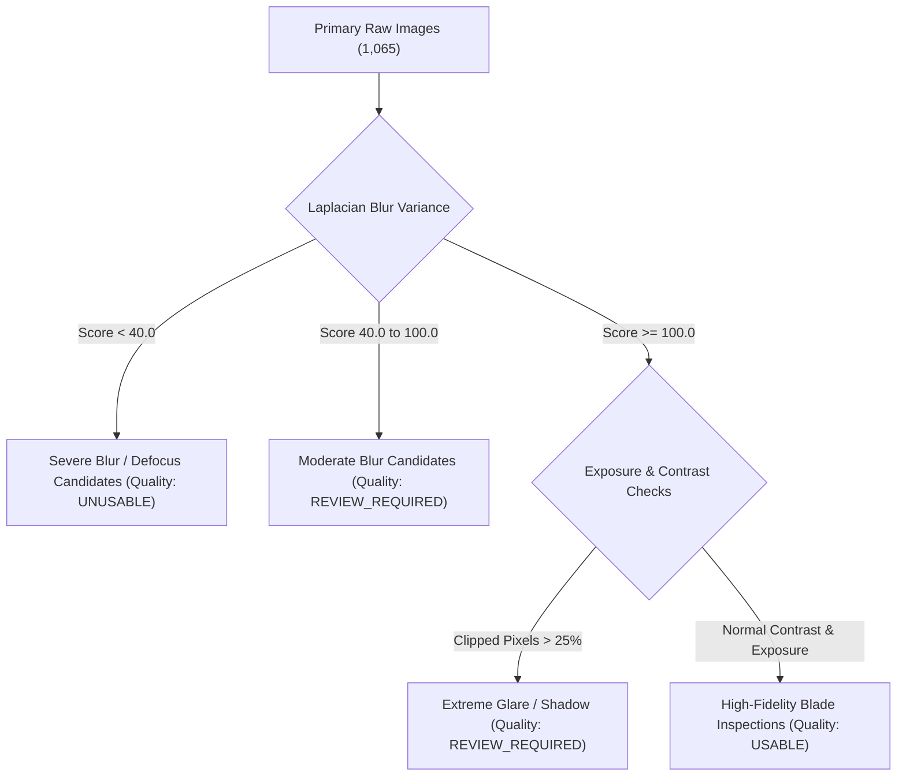

# AeroLoss AI — Model 1 Benchmark Design, Sampling Targets, and Grouping Plan

**Document Path:** `reports/model1_dataset_preparation/model1_benchmark_plan.md`  
**Target Component:** Model 1 — Image Quality and Blade-Relevance Guardrail  
**Author:** Senior Deep-Learning Engineer & Computer-Vision Data Engineer  
**Date:** 2026-10-20  

---

## 1. Executive Benchmark Strategy

The Model 1 guardrail must be calibrated and evaluated against an **independent, leak-free, multi-modal benchmark** that tests both:
1. **Relevance Discrimination:** Distinguishing authentic wind turbine blades from diverse real-world distractors and digital artifacts.
2. **Quality Grading:** Distinguishing sharp, well-illuminated inspection photographs from degraded, blurred, overexposed, or uninformative uploads.

---

## 2. Benchmark Composition: Target Goals vs Current Repository Inventory

To achieve statistically robust evaluation across varying operational conditions, we establish an initial planning target of **400 reviewed benchmark images**. Below is the empirical comparison of our target composition against the actual images available inside `C:\Users\akhil\.gemini\antigravity\scratch\aeroloss_ai`:

| Benchmark Stratum | Description & Inclusion Profile | Target Count | Available in Repository | Inventory Status / Gap Analysis |
| :--- | :--- | :--- | :--- | :--- |
| **Stratum 1: Standard In-Domain Blades** | Sharp, well-framed drone inspection photographs of turbine blades under clear daytime lighting ($\sigma^2_{\text{Lap}} \ge 100$). | `150` | `1,065` | **SURPLUS:** Plentiful candidates available in `data/raw/images/`. |
| **Stratum 2: Degraded / Difficult Blades** | Genuine blade inspections with adverse optical conditions (severe glare, backlighting, motion blur, low contrast, oblique angle). | `75` | Estimated `~120` within raw images | **AVAILABLE:** Can be sampled from raw dataset via computed quality metrics (lowest quartile of blur variance and extreme brightness). |
| **Stratum 3: Unrelated Real-World Photography** | High-fidelity photographs of animals, humans, vehicles, industrial non-turbine structures, solar panels, and buildings. | `100` | `13` (unique) | **CRITICAL DEFICIT (-87 images):** Repository currently contains only 13 unique real-world non-blade images in `data/negative_evaluation_samples/`. |
| **Stratum 4: Graphics, Diagrams, Noise & Synthetic Artifacts** | Clean charts, confusion matrices, workflow infographics, screenshots, and pure synthetic noise (blank, gaussian, salt-pepper). | `75` | `14` (unique) | **DEFICIT (-61 images):** Repository contains only 14 unique synthetic/diagram images in `data/negative_evaluation_samples/`. |
| **Total Benchmark Target** | Multi-class balanced guardrail benchmark | **400** | **225 + 27 = 252** | **NET DEFICIT (-148 negative images):** Must be explicitly acquired or sampled prior to final statistical ROC calibration. |

> [!IMPORTANT]
> **No Fake Data Policy:**  
> The 148-image negative deficit must not be solved by fabricating synthetic images or guessing labels. In the interim, Model 1's initial pilot validation will operate on the **252 available and verified examples** (225 stratified blade images + 27 unique negative evaluation images).

---

## 3. Stratified Sampling Plan for Blade Quality Tiers

Using the empirical measurements computed in `model1_image_manifest.csv`, the 1,065 primary blade images can be objectively stratified into representative candidate tiers for human quality review:

### Empirical Distribution in Primary Benchmark:
- **Sharp / High-Frequency Images ($\sigma^2_{\text{Lap}} \ge 100$):** `642 images` (60.3%)
- **Moderate Frequency / Soft Focus ($40 \le \sigma^2_{\text{Lap}} < 100$):** `348 images` (32.7%)
- **Low Frequency / Blur Candidates ($\sigma^2_{\text{Lap}} < 40$):** `75 images` (7.0%)
- **High Glare / Overexposed ($I_{\ge 245} > 15\%$):** `94 images` (8.8%)
- **Deep Shadow / Underexposed ($I_{\le 15} > 15\%$):** `28 images` (2.6%)

---

## 4. Grouping Strategy and Leakage Prevention

To ensure zero evaluation contamination, images must be partitioned at the **group cluster level**, rather than by independent random assignment:

### 4.1 Exact Duplicate Quarantine
The 5 exact duplicate groups (10 files total) must never have group members separated across different splits:
- `EXACT_DUP_01`: `547.jpg` and `640.jpg` (Primary) &rarr; Keep canonical `547.jpg` in Train; quarantine `640.jpg`.
- `EXACT_DUP_02`: `565.jpg` and `668.jpg` (Primary) &rarr; Keep canonical `565.jpg` in Train; quarantine `668.jpg`.
- `EXACT_DUP_03`: `animal_bird_01.jpg` and `animal_bird_coucal_02.jpg` (Negative) &rarr; Keep canonical in Test; quarantine duplicate.
- `EXACT_DUP_04`: `chart_confusion_matrix_03.png` and `chart_decision_matrix_04.png` (Negative) &rarr; Quarantine duplicate.
- `EXACT_DUP_05`: `chart_feature_importance_01.png` and `chart_feature_importance_02.png` (Negative) &rarr; Quarantine duplicate.

### 4.2 Perceptual Hash (dHash) Cluster Grouping
- Our pairwise scan revealed **308 near-duplicate image pairs** ($Hamming \le 2$).
- Connected-component clustering yielded **78 near-duplicate multi-image clusters** (`NEAR_DUP_01` to `NEAR_DUP_78`) containing 263 total images.
- *Policy:* All members of a near-duplicate cluster represent consecutive drone flight captures of the same blade region. The entire cluster must be assigned atomically to a single split (all in Train, all in Val, or all in Test).

---

## 5. Proposed Partitioning Scheme for Model 1 Evaluation

When the benchmark dataset is finalized, splits will be assigned following a **60% Development / 20% Validation / 20% Final Holdout Test** ratio:

| Partition | Target Blade Images | Target Negative Images | Split Role & Requirements |
| :--- | :--- | :--- | :--- |
| **Development (Train)** | `135` (90 sharp, 45 degraded) | `60` (40 real, 20 synthetic) | Used for calibrating guardrail feature distributions and training domain classifiers. |
| **Validation (Val)** | `45` (30 sharp, 15 degraded) | `20` (15 real, 5 synthetic) | Used for tuning threshold operating points (FPR vs FNR tradeoff). Must contain negative classes seen in training. |
| **Final Test (Holdout)** | `45` (30 sharp, 15 degraded) | `20` (15 real, 5 synthetic) | **Strictly untouched test set.** Must include *unseen* negative distractor categories to test open-set generalization. |

---

## 6. Execution Roadmap for Model 1

1. **Step 1 (Immediate):** Formulate the detailed audit report (`model1_dataset_audit.md`) and verify all generated manifest files.
2. **Step 2 (Prompt 2):** Calibrate empirical thresholds for Laplacian blur, histogram dynamic range, and HSV blade composite color variance using the stratified sample tiers.
3. **Step 3 (Prompt 3):** Implement the standalone Model 1 Image Quality & Blade Relevance Guardrail module with structured JSON diagnostic output.
