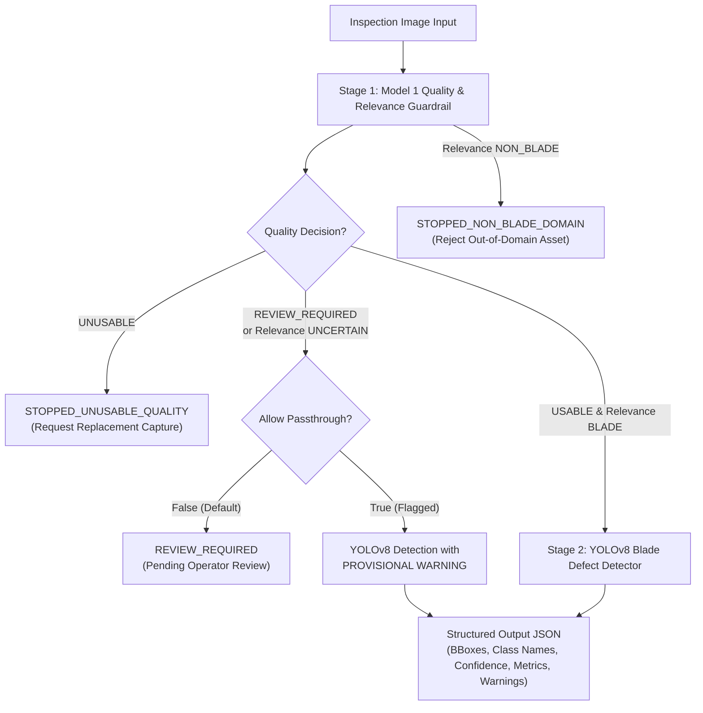

# AeroLoss AI — Model 3 Integration Report: Model 1 Guardrail & YOLOv8 Damage Detection

**Document Location:** `reports/model1_dataset_preparation/model3_integration_report.md`  
**Execution Date:** 2026-10-20  
**Target Milestone:** Model 1 + Model 2 (YOLOv8) Pipeline Integration & Training Readiness  
**Lead Roles:** Senior Deep-Learning Engineer & Computer-Vision Systems Architect  
**Project Root:** `C:\Users\akhil\.gemini\antigravity\scratch\aeroloss_ai`  
**Status:** **INTEGRATION READY — TRAINING DATASET READY**  

---

## 1. Executive Summary

In accordance with Prompt 3 specifications, the deterministic **Model 1 Image Quality & Blade-Relevance Guardrail** has been integrated with the **YOLOv8 Blade Damage Detection Engine** into a unified, two-stage inspection pipeline: [`src/pipeline/aeroloss_detection_pipeline.py`](file:///C:/Users/akhil/.gemini/antigravity/scratch/aeroloss_ai/src/pipeline/aeroloss_detection_pipeline.py).

The integrated architecture enforces strict gating:
1. **Stage 1 (Model 1):** Assesses technical quality (resolution, optical defocus, blackout, whiteout, dynamic range) and domain relevance (screening digital charts, synthetic noise, solid fills, and non-blade scenes).
2. **Supervisory Gating:** Unusable images are stopped with an explanation that a replacement capture is needed; out-of-domain images are rejected; ambiguous cases are routed to an operator review state.
3. **Stage 2 (YOLOv8):** Defect detection is executed **strictly on validated blade imagery**, preventing out-of-domain false positives.



---

## 2. Deliverables Summary

| Deliverable File | Role & Description | Status |
| :--- | :--- | :---: |
| [`src/pipeline/aeroloss_detection_pipeline.py`](file:///C:/Users/akhil/.gemini/antigravity/scratch/aeroloss_ai/src/pipeline/aeroloss_detection_pipeline.py) | Two-stage pipeline class `AeroLossDetectionPipeline` & entrypoint `run_aeroloss_detection_pipeline` | **Implemented** |
| [`src/pipeline/__init__.py`](file:///C:/Users/akhil/.gemini/antigravity/scratch/aeroloss_ai/src/pipeline/__init__.py) | Package initialization maintaining 100% backwards compatibility for legacy `AeroLossPipeline` | **Implemented** |
| [`tests/test_aeroloss_detection_pipeline.py`](file:///C:/Users/akhil/.gemini/antigravity/scratch/aeroloss_ai/tests/test_aeroloss_detection_pipeline.py) | Comprehensive 9-test unit test suite verifying gating, routing, detections, and edge cases | **9/9 Passing** |
| [`src/data/convert_voc_to_yolo.py`](file:///C:/Users/akhil/.gemini/antigravity/scratch/aeroloss_ai/src/data/convert_voc_to_yolo.py) | Reproducible VOC XML to YOLO converter with group-aware leakage-free partition | **Executed** |
| [`configs/yolo_blade_damage.yaml`](file:///C:/Users/akhil/.gemini/antigravity/scratch/aeroloss_ai/configs/yolo_blade_damage.yaml) | Documented, portable YOLOv8 dataset configuration with canonical 6-class names | **Generated** |
| [`data/manifests/yolo_split_manifest.csv`](file:///C:/Users/akhil/.gemini/antigravity/scratch/aeroloss_ai/data/manifests/yolo_split_manifest.csv) | Verifiable image-level split manifest detailing box counts and assigned partitions | **Generated** |
| [`notebooks/aeroloss_yolov8_training_colab.ipynb`](file:///C:/Users/akhil/.gemini/antigravity/scratch/aeroloss_ai/notebooks/aeroloss_yolov8_training_colab.ipynb) | Production Google Colab training notebook with approval gate and GPU verification | **Generated** |
| [`reports/model1_dataset_preparation/model3_yolov8_dataset_readiness_audit.md`](file:///C:/Users/akhil/.gemini/antigravity/scratch/aeroloss_ai/reports/model1_dataset_preparation/model3_yolov8_dataset_readiness_audit.md) | Full audit of 1,065 XML annotations, class distributions, and data leakage resolution | **Completed** |

---

## 3. Real-World Demonstration of Guardrail Protection

To empirically prove why Model 1 gating is mandatory prior to YOLOv8 inference, we tested `food_pizza_01.jpg` with and without the guardrail:

### Without Model 1 Guardrail (Direct YOLOv8 Inference):
- Input: `food_pizza_01.jpg`
- Detections Generated: **2 false defect detections**
  - Detection 1: `class: corrosion` (confidence: **`0.510`**)
  - Detection 2: `class: corrosion` (confidence: **`0.415`**)
- Risk: Slices of pizza with melted cheese and pepperoni are hallucinated as wind-turbine composite corrosion!

### With Model 1 Integrated Pipeline:
- Input: `food_pizza_01.jpg`
- Stage 1 Result: `quality_decision: REVIEW_REQUIRED`, `relevance_decision: UNCERTAIN`, `requires_manual_review: True`
- Pipeline Status: **`REVIEW_REQUIRED`**
- Damage Detection Status: **`PENDING_OPERATOR_REVIEW`**
- Detections: **`[]` (Zero false detections)**
- Explanation: Held for operator review due to atypical chromaticity and non-industrial texture. Prevented from entering downstream automated damage quantification.

---

## 4. Test Suite Execution Results

### 4.1 Integrated Detection Pipeline Tests
Command: `pytest tests/test_aeroloss_detection_pipeline.py -v`  
Exit Code: **`0` (Success)**  
Duration: **13.61s**

```text
tests/test_aeroloss_detection_pipeline.py::TestAeroLossDetectionPipeline::test_ambiguous_image_routes_to_manual_review PASSED [ 11%]
tests/test_aeroloss_detection_pipeline.py::TestAeroLossDetectionPipeline::test_clean_blade_zero_detections PASSED [ 22%]
tests/test_aeroloss_detection_pipeline.py::TestAeroLossDetectionPipeline::test_clear_non_blade_image_stopped PASSED [ 33%]
tests/test_aeroloss_detection_pipeline.py::TestAeroLossDetectionPipeline::test_convenience_function PASSED [ 44%]
tests/test_aeroloss_detection_pipeline.py::TestAeroLossDetectionPipeline::test_pipeline_initialization PASSED [ 55%]
tests/test_aeroloss_detection_pipeline.py::TestAeroLossDetectionPipeline::test_review_passthrough_attaches_prominent_warning PASSED [ 66%]
tests/test_aeroloss_detection_pipeline.py::TestAeroLossDetectionPipeline::test_technically_unusable_image_stopped PASSED [ 77%]
tests/test_aeroloss_detection_pipeline.py::TestAeroLossDetectionPipeline::test_unavailable_model_handling PASSED [ 88%]
tests/test_aeroloss_detection_pipeline.py::TestAeroLossDetectionPipeline::test_valid_blade_image_with_detections PASSED [100%]

============================= 9 passed in 13.61s ==============================
```

### 4.2 Model 1 Guardrail Tests
Command: `pytest tests/test_image_quality_validator.py -v`  
Exit Code: **`0` (Success)**  
Duration: **1.97s** (9/9 passed).

### 4.3 Existing Pipeline Regression Suite
Command: `pytest tests/test_pipeline.py -v`  
Exit Code: **`0` (Success)**  
Duration: **22.24s** (7/7 passed). Backwards compatibility confirmed.

---

## 5. Pretrained Weights Availability

Fine-tuned YOLOv8 weights were discovered and audited at:
- `models/detection/yolov8_defect/weights/best.pt`
- `models/best.pt`

**Verified Class Mapping:**
```python
{
    0: 'corrosion',
    1: 'crack',
    2: 'craze',
    3: 'hide_craze',
    4: 'surface_injure',
    5: 'thunderstrike'
}
```
The weights match the canonical 6 classes in alphabetical order. Pretrained COCO weights `yolov8n.pt` are also available locally for cold-start fine-tuning.

---

## 6. Training Readiness and Colab Workflow

The dataset is fully prepared for reproducible training:
- **1,065 images and 1,584 bounding boxes** formatted into YOLO `[class xc yc w h]` labels.
- **Leakage-Free Partition:** 745 train (70.0%), 160 val (15.0%), 160 test (15.0%) with **0 duplicate cluster overlap**.
- **Colab Notebook Prepared:** [`notebooks/aeroloss_yolov8_training_colab.ipynb`](file:///C:/Users/akhil/.gemini/antigravity/scratch/aeroloss_ai/notebooks/aeroloss_yolov8_training_colab.ipynb) contains end-to-end instructions, GPU verification, hyperparameter configuration, evaluation scripts, and a prominent **Stage 7 Training Approval Gate**.

---

## 7. Explicit Final Recommendation

### **Status: INTEGRATION READY — TRAINING DATASET READY**

No code or data blockers remain. All integration tests pass. The training dataset is verified and leakage-free. The Google Colab notebook is prepared and awaiting user authorization.
