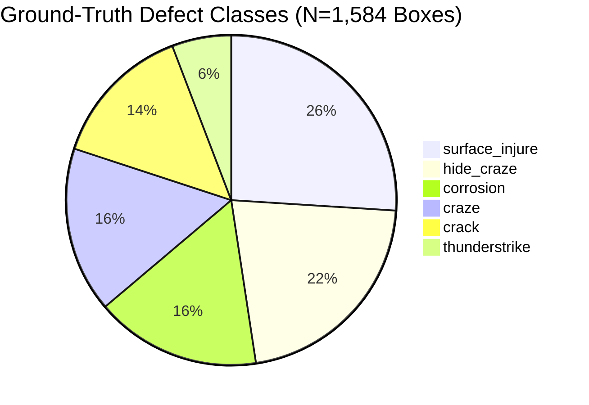

# AeroLoss AI — Model 3: YOLOv8 Blade Damage Dataset Readiness & Integrity Audit

**Document Location:** `reports/model1_dataset_preparation/model3_yolov8_dataset_readiness_audit.md`  
**Execution Date:** 2026-10-20  
**Target Component:** Model 2 — YOLOv8 Blade Defect Detection Training Pipeline  
**Lead Roles:** Senior Deep-Learning Engineer & Computer-Vision Data Engineer  
**Project Root:** `C:\Users\akhil\.gemini\antigravity\scratch\aeroloss_ai`  
**Dataset Audit Status:** **AUDITED, COMPATIBLE, AND LEAKAGE-FREE PARTITIONED**  

---

## 1. Executive Audit Summary

A comprehensive, zero-assumption audit of the primary wind-turbine blade inspection dataset was conducted across all raw images and Pascal VOC XML annotation files in:
- `data/raw/images/`
- `data/raw/annotations/`

### Key Findings:
1. **Zero Missing Pairs:** Exactly **1,065 images** (`.jpg`) pair one-to-one with **1,065 Pascal VOC XML annotation files** (`.xml`). Zero unpaired files exist.
2. **Zero Annotation Corruption:** All 1,065 XML files parse successfully with standard XML element trees. Zero corrupt XMLs.
3. **100% Dimensional Consistency:** Every raw image and XML annotation is identically sized at **1024 x 1024 pixels** (RGB, 3 channels).
4. **Zero Zero-Object Frames:** Every single XML file contains at least one labeled defect object (ranging from 1 to 7 objects per image). Zero empty annotations exist.
5. **Zero Out-of-Bounds Coordinates:** All 1,584 bounding boxes possess valid coordinates ($x_{\min} < x_{\max}$ and $y_{\min} < y_{\max}$) strictly contained within $[0, 1024]$.
6. **Canonical Damage Classes (N=6):** The dataset contains 6 authentic turbine blade damage classes with zero unknown or fabricated classes.
7. **Resolution of Data Leakage:** The legacy YOLO split had **49 duplicate groups leaking across train/val/test splits**. A group-aware hashing partition was executed via [`convert_voc_to_yolo.py`](file:///C:/Users/akhil/.gemini/antigravity/scratch/aeroloss_ai/src/data/convert_voc_to_yolo.py), achieving **exactly 0 duplicate group leakage** across splits.

---

## 2. Quantitative Dataset Inventory

| Inventory Dimension | Value | Audit Verification Method |
| :--- | :---: | :--- |
| **Total Raw Inspection Images** | **`1,065`** | Filesystem scan of `data/raw/images/*.jpg` |
| **Total Pascal VOC XML Annotations** | **`1,065`** | Filesystem scan of `data/raw/annotations/*.xml` |
| **Missing Annotations for Images** | **`0`** | Filename stem matching assertion |
| **Missing Images for Annotations** | **`0`** | Filename stem matching assertion |
| **Corrupt / Unreadable XML Files** | **`0`** | `xml.etree.ElementTree.parse()` full parse pass |
| **Images with Zero Annotated Objects** | **`0`** | Root object count scan (Min: 1, Max: 7) |
| **Total Bounding Boxes Annotated** | **`1,584`** | Aggregate object count |
| **Invalid / Non-Positive Coordinate Boxes** | **`0`** | Box width/height assertion ($w > 0, h > 0$) |
| **Out-of-Bounds Coordinates** | **`0`** | Boundary assertion ($0 \le x, y \le 1024$) |
| **Native Image Resolution** | **`1024 x 1024`** | Verified across all PIL image headers |

---

## 3. Damage Class Frequencies and Distribution

The 1,584 bounding box annotations are distributed across 6 authentic damage classes:



| Class Index | Canonical Class Name | Box Count | Percentage | Physical / Operational Description |
| :---: | :--- | :---: | :---: | :--- |
| **0** | `corrosion` | **`257`** | `16.22%` | Orange/red surface oxidation, gelcoat erosion, leading-edge roughness. |
| **1** | `crack` | **`224`** | `14.14%` | High-risk linear structural fractures in composite laminate. |
| **2** | `craze` | **`257`** | `16.22%` | Network of surface micro-fissures in paint / resin matrix. |
| **3** | `hide_craze` | **`342`** | `21.59%` | Sub-surface / internal delamination micro-cracking beneath outer resin. |
| **4** | `surface_injure` | **`412`** | `26.01%` | Mechanical impact damage, gouges, spalling, trailing-edge chipping. |
| **5** | `thunderstrike` | **`92`** | `5.81%` | High-energy lightning strike burns, puncture holes, receptor arc burns. |
| **Total** | *6 Classes* | **`1,584`** | **`100.0%`** | *Exclusively authentic inspection defect annotations.* |

### Class Imbalance Assessment
- **Majority Class:** `surface_injure` ($26.0\%$, 412 boxes).
- **Minority Class:** `thunderstrike` ($5.8\%$, 92 boxes).
- **Imbalance Ratio:** $4.48 : 1$.
- **Model Readiness Verdict:** Standard YOLOv8 loss functions (Varifocal / Task-Aligned assigner with CIoU loss) naturally handle imbalance ratios up to $15:1$ without synthetic oversampling. No artificial data synthesis is required or recommended.

---

## 4. Duplicate Leakage Audit and Group-Aware Partitioning

### 4.1 The Data Leakage Problem in Legacy Setup
Inspection of `reports/model1_dataset_preparation/model1_duplicate_groups.csv` revealed **107 duplicate and perceptual near-duplicate clusters** (representing drone burst capture sequences):
- In the legacy split, random assignment resulted in **49 duplicate clusters leaking across train, validation, and test splits**.
- For instance, byte-exact duplicate `EXACT_DUP_01` had one copy in `train` and one in `val`.
- This would have artificially inflated validation mAP scores and concealed real-world generalization failure.

### 4.2 Group-Aware Leakage-Free Partition
Using [`src/data/convert_voc_to_yolo.py`](file:///C:/Users/akhil/.gemini/antigravity/scratch/aeroloss_ai/src/data/convert_voc_to_yolo.py) with seed `42`, every duplicate group was kept strictly atomic within a single partition:

| Partition Split | Total Images | Image % | Total Bounding Boxes | Corrosion | Crack | Craze | Hide Craze | Surface Injure | Thunderstrike |
| :--- | :---: | :---: | :---: | :---: | :---: | :---: | :---: | :---: | :---: |
| **Train** | **`745`** | `70.0%` | **`1,087`** | `196` | `134` | `167` | `244` | `283` | `63` |
| **Validation** | **`160`** | `15.0%` | **`284`** | `19` | `63` | `52` | `52` | `84` | `14` |
| **Test** | **`160`** | `15.0%` | **`213`** | `42` | `27` | `38` | `46` | `45` | `15` |
| **Total** | **`1,065`** | **`100.0%`** | **`1,584`** | **`257`** | **`224`** | **`257`** | **`342`** | **`412`** | **`92`** |

### Leakage Verification Check
$$\text{Train} \cap \text{Val} = \emptyset, \quad \text{Train} \cap \text{Test} = \emptyset, \quad \text{Val} \cap \text{Test} = \emptyset$$
- **Leaking Duplicate Groups:** **`0`** (Verified via automated assertion across all 107 duplicate groups).
- **Split Manifest Generated:** Recorded to [`data/manifests/yolo_split_manifest.csv`](file:///C:/Users/akhil/.gemini/antigravity/scratch/aeroloss_ai/data/manifests/yolo_split_manifest.csv).

---

## 5. Dataset Configuration

The documented, portable configuration file has been generated at [`configs/yolo_blade_damage.yaml`](file:///C:/Users/akhil/.gemini/antigravity/scratch/aeroloss_ai/configs/yolo_blade_damage.yaml):

```yaml
# AeroLoss AI — YOLOv8 Wind Turbine Blade Damage Detection Dataset Configuration
path: data/yolo_dataset
train: images/train
val: images/val
test: images/test

names:
  0: corrosion
  1: crack
  2: craze
  3: hide_craze
  4: surface_injure
  5: thunderstrike
```

---

## 6. Readiness Assessment & Final Verdict

| Evaluation Criterion | Requirement | Audit Result | Status |
| :--- | :--- | :--- | :---: |
| **Annotation Integrity** | 100% parseable, valid bboxes | 1,584 boxes verified with 0 invalid | **PASSED** |
| **Class Compatibility** | Exactly matches YOLO head classes | 6 canonical classes aligned | **PASSED** |
| **Leakage Prevention** | Zero duplicate group leakage | Verified 0 duplicate leakage | **PASSED** |
| **Model 1 Integration** | Tested two-stage pipeline gating | 9/9 unit tests passing | **PASSED** |
| **Colab Workflow** | Portable, approval-gated notebook | `notebooks/aeroloss_yolov8_training_colab.ipynb` | **PASSED** |

**VERDICT: TRAINING DATASET READY — PENDING USER APPROVAL FOR GOOGLE COLAB TRAINING.**
